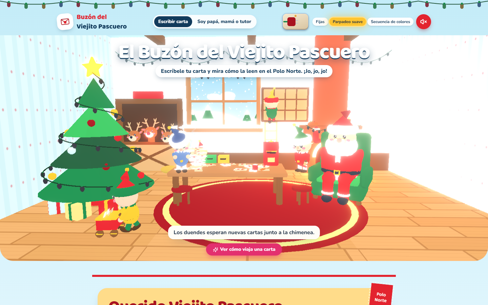
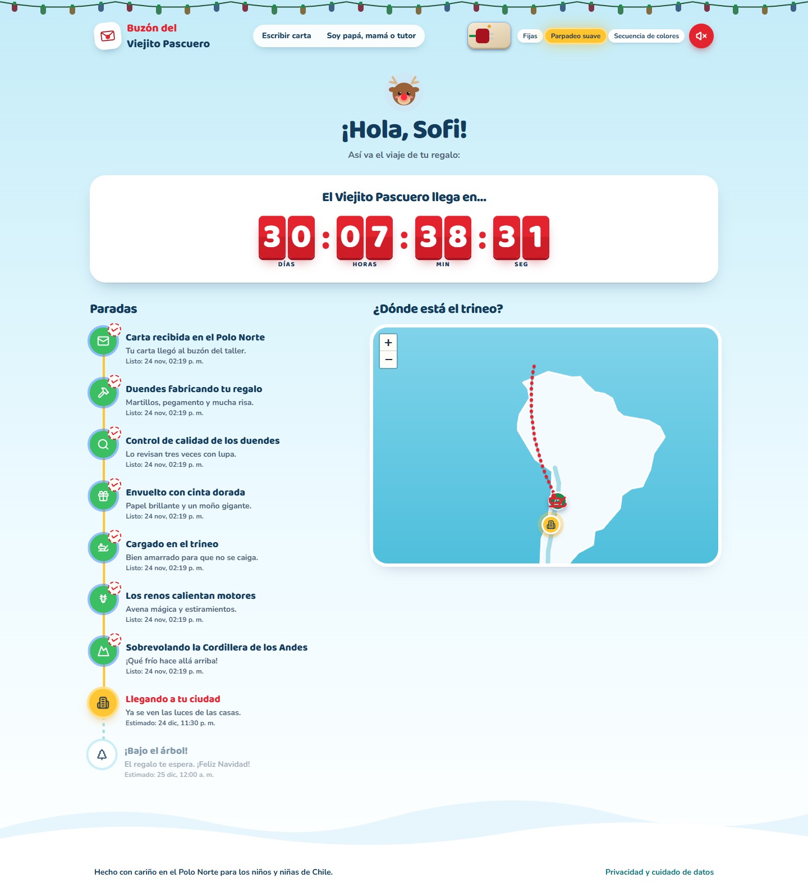

# Buzón del Viejito Pascuero

Web navideña chilena donde niños y niñas le escriben al **Viejito Pascuero**. Un taller 3D del Polo Norte, cálido y de cuento ilustrado, muestra al Viejito, cinco duendes y tres renos leyendo cada carta. Las cartas fotografiadas se leen con OCR y, si este falla, con IA de visión. Los papás, mamás y tutores siguen el viaje del regalo parada por parada, en tiempo real.



| Móvil | Seguimiento del regalo |
|---|---|
|  |  |

## Levantar todo con un comando

```bash
cp .env.example .env      # en Windows: copy .env.example .env
docker compose up --build
```

Luego abre **http://localhost:8080**. Docker levanta `frontend` (nginx), `backend` (FastAPI), `worker` (RQ), `postgres` y `redis`.

- La primera build instala EasyOCR y TrOCR (PyTorch CPU, unos 2 GB). Para una imagen liviana que solo use Tesseract: `INSTALL_ML=false docker compose up --build`.
- Los modelos se descargan la primera vez que se usan y quedan en el volumen `models`.

## Publicar en Vercel

Vercel sirve la web (React/Vite). El backend (FastAPI con OCR, PostgreSQL, Redis y WebSockets) no corre en Vercel: va en un servicio que acepte contenedores (Render, Railway, Fly.io, un VPS…) con `backend/Dockerfile`.

1. **Importa el repo** en Vercel con la carpeta raíz del repositorio (no `frontend/`). `vercel.json` ya define la instalación y el build; no hay que elegir framework.
2. **Variables de entorno en Vercel** (Settings → Environment Variables):

   | Variable | Ejemplo | Para qué |
   | --- | --- | --- |
   | `BACKEND_URL` | `https://api.tudominio.cl` | Vercel reenvía `/api/*` a esta URL (proxy). El navegador ve un solo origen, así las cookies de sesión y el CSRF funcionan igual que en Docker. Sin ella la web queda en **modo vitrina**: la escena 3D y la demo de la carta funcionan, `/api` responde 503. |
   | `VITE_WS_URL` | `wss://api.tudominio.cl` | Vercel no reenvía WebSockets: el seguimiento en vivo se conecta directo al backend. Se agrega solo a la CSP. |
   | `VITE_MAP_TILES_URL` | (opcional) | Teselas del mapa del trineo. |

3. **Variables del backend** (donde lo publiques): `ENVIRONMENT=production`, `SECRET_KEY` fuerte, `COOKIE_SECURE=true`, `CORS_ORIGINS=https://tu-proyecto.vercel.app` (también lo usa el WebSocket para validar el origen) y `TRUST_FORWARDED_FOR=true` para que el rate limit vea la IP real de cada visitante y no la de Vercel. Activa esa última solo si el backend no queda expuesto directo a internet sin pasar por Vercel.

Cómo funciona: el build corre `npm run build` en `frontend/` y luego `frontend/scripts/vercel-output.mjs`, que arma `.vercel/output` (Build Output API): rutas de la SPA, las mismas cabeceras de seguridad que `nginx.conf`, caché larga para `/assets` y el proxy de `/api`. Como la cookie de sesión es del dominio de Vercel y no viaja al WebSocket del backend, el estado de una carta recién enviada también se consulta cada 3 s mientras el Viejito la lee (`usePollLetterStatus` en `features/auth/session.tsx`); en Docker el WebSocket sigue siendo la vía principal.

Para revisar la salida en local: `npm run build --prefix frontend && node frontend/scripts/vercel-output.mjs`.

## Desarrollo local (sin Docker)

**Backend** (Python 3.12 o superior; usa SQLite y `BackgroundTasks`, sin Redis):

```bash
cd backend
python -m venv .venv && .venv/Scripts/activate   # macOS/Linux: source .venv/bin/activate
pip install -r requirements-dev.txt               # + requirements-ml.txt si quieres EasyOCR/TrOCR
alembic upgrade head
uvicorn app.main:app --reload --port 8000
```

**Frontend:**

```bash
cd frontend
npm install
npm run dev               # http://localhost:5173 (proxy /api y /ws → :8000)
```

Si el backend corre en otro puerto, crea `frontend/.env.local` con `API_TARGET=http://localhost:8010`.

## Calidad

| Comando | Qué revisa |
|---|---|
| `cd backend && pytest` | 41 tests: auth, CSRF, rate limit, permisos entre cuentas, pipeline OCR con imágenes de prueba, criterio de fallback, PII, EXIF/GPS, tracking, WebSocket |
| `cd backend && ruff check app tests && mypy app` | lint y tipos estrictos |
| `cd frontend && npm test` | 41 tests de Vitest y Testing Library: stores, luces, tiempos, formulario de carta, interruptor accesible, geometría del Viejito, cinta mágica y apertura de libro |
| `cd frontend && npm run lint && npm run typecheck` | ESLint (con jsx-a11y) y TypeScript strict |

Las imágenes de prueba están en `backend/tests/fixtures/` y se regeneran con `python tests/fixtures/make_fixtures.py`. El test con Tesseract real se salta si el binario no está instalado.

## Gráficos 3D: skills y validación

El repo incluye en `.claude/skills/` el pack [Three.js Awesome Graphics Agent Skills](https://github.com/scottstts/Threejs-Awesome-Graphics-Agent-Skills) (MIT, commit `53eb5a2`). Se copió la carpeta `skills/` sin ejecutar su instalador de npm. Lo que se aplicó a la escena:

- **Exposición y color:** un solo dueño del tone mapping, Neutral (Khronos), que conserva la paleta plana. Lo aplica el renderer cuando no hay postprocesado y el efecto final cuando sí; así la imagen no cambia al bajar la calidad.
- **Bloom:** se calcula en HDR antes del tone mapping, con umbral 1,2 y una jerarquía de emisión con nombre (`EMISSION` en `components/scene/kit.ts`). Solo brillan las ampolletas, la nariz del reno, la cinta dorada y su polvo de estrellas, y la estrella del árbol.
- **Cámara:** riel entre dos planos con una sola etapa de interpolación (resorte críticamente amortiguado y bloqueo exacto al llegar). El parallax va aparte y acotado.
- **Animación procedural:** todo se mueve con `dt` acotado (estable tras suspender la pestaña) y con azar sembrado.

Controles de validación visual por URL (`components/scene/debug.ts`):

| Parámetro | Efecto |
|---|---|
| `?seed=7` | semilla de nieve, polvo de estrellas y orejas |
| `?post=off` | línea base sin postprocesado |
| `?t=4` | congela el reloj de la escena en ese segundo |
| `?quality=0\|1\|2` | fuerza el nivel de calidad |
| `?shot=santa\|santa34\|santaside` | vista fija de inspección del Viejito |

Ejemplo: `/?seed=7&t=4` y `/?seed=7&t=4&post=off` deben verse iguales salvo el brillo del bloom.

## Arquitectura

El plan completo, con modelo de datos, endpoints y eventos, está en [docs/PLAN.md](docs/PLAN.md).

```
frontend/src
  app/              router, layout (guirnalda CSS, interruptor de luces, audio)
  components/scene  escena R3F: sala, chimenea (shader), cielo de día con nubes (shader), nieve instanciada,
                    guirnaldas (1 InstancedMesh + 3 PointLights), Viejito, duendes, renos,
                    cinemática de la carta, cinta dorada mágica, cámara con riel y parallax
  components/ui     botón mágico, sobre lacrado, palanca de luces, loader del trineo, íconos propios
  features/         letters · auth · parents · tracking
  stores/           Zustand: luces (persistidas), escena (máquina de estados), sesión
backend/app
  api/              auth, niños, cartas, trayecto, vista pública de seguimiento
  core/             config, seguridad (argon2, JWT, CSRF), rate limit, cabeceras
  services/         uploads (MIME real, sin EXIF), ocr (OpenCV + motores), vision_providers,
                    letter_pipeline, pii, tracking (auto-avance), retention
  ws/               hub de eventos (memoria o Redis pub/sub)
  workers/          worker RQ
```

### Pipeline de cartas

1. **Validación:** tipo real por *magic bytes*, máximo 10 MB y PDF de hasta 5 páginas. La imagen se re-dibuja desde los píxeles, lo que elimina EXIF y GPS.
2. **OpenCV:** escala de grises, corrección de perspectiva, deskew, reducción de ruido y binarización adaptativa.
3. **OCR:** EasyOCR → PaddleOCR → Tesseract (`OCR_ENGINE=auto`), con confianza promedio por línea.
4. **Criterio de fallo:** confianza menor a `OCR_MIN_CONFIDENCE`, menos de `OCR_MIN_VALID_WORDS` palabras en español plausibles, o caracteres basura sobre `OCR_MAX_GARBAGE_RATIO`.
5. **IA de visión:** interfaz `VisionReader`. TrOCR local por defecto; Gemini, Groq u OpenRouter solo con API key **y** consentimiento del padre.
6. **Extracción:** se valida con Pydantic (`CartaExtraida`) y entrega texto original, texto normalizado, regalos, tono, confianza y método.
7. **Datos sensibles:** RUT, teléfonos, correos, direcciones y colegios se reemplazan por `[🔒 dato protegido]`.
8. **Si todo falla:** la carta queda en *Necesita ayuda de un duende*, la foto se conserva y el padre la transcribe en el panel.
9. **Tiempo real:** cada cambio de estado se emite por WebSocket y la escena 3D reacciona.

## Decisiones (y por qué)

Cuando el brief era ambiguo, elegimos la opción más tierna, accesible y segura para niños:

- **Enviar una carta requiere la sesión del adulto.** El niño puede escribir, pero la carta solo se guarda en una cuenta familiar. Para curiosear sin cuenta está el botón *Ver cómo viaja una carta*, que reproduce la cinemática sin guardar nada.
- **La vista del niño es un enlace con código no adivinable** (`/seguimiento/<código>`) y de solo lectura. Muestra apodo, avatar y paradas; nunca cartas ni datos del adulto.
- **Llegada por defecto:** medianoche entre el 24 y el 25 de diciembre, hora de `America/Santiago`. Todas las fechas se guardan en UTC con un tipo de columna propio, porque SQLite perdía el offset.
- **El mapa no usa teselas de terceros por defecto.** Dibuja una Sudamérica estilizada de día (mar turquesa, tierra nevada), así no se filtran coordenadas a otros servicios. `VITE_MAP_TILES_URL` permite activar teselas.
- **Retención:** la foto se borra apenas la carta queda leída. Si necesita ayuda, se guarda hasta que el adulto la transcriba, con un máximo de `RETENTION_DAYS` (60 días).
- **IA externa desactivada por defecto.** Se activa con una casilla explícita en el panel. Sin esa aceptación se usa TrOCR local aunque `VISION_PROVIDER` apunte a un proveedor externo.
- **Fuentes autoalojadas** (`@fontsource`), sin llamadas a Google Fonts.
- **El audio siempre arranca silenciado** en cada visita y se sintetiza con WebAudio, sin descargar archivos.
- **`prefers-reduced-motion`:** el vuelo del sobre dura un cuarto y sin estela, sin parallax ni parpadeo de luces, con amplitudes al 15 %. La fase "Leyendo…" conserva su duración porque es estado, no desplazamiento. La UI 2D desactiva sus transiciones.
- **Rendimiento:** DPR limitado a 2 y `PerformanceMonitor` en 3 niveles (sin SMAA → sin Bloom ni luces extra). Las geometrías y materiales son compartidos y la nieve, las ampolletas y el polvo de estrellas son instanciados; las cintas doradas reservan su búfer una sola vez. La escena se carga diferida y la carta se puede escribir antes de que termine de cargar.
- **Estilo visual: taller de cuento.** Sigue el boceto animado y las láminas de referencia del buzón (personajes, duendes y utilería): taller cálido de madera miel y chimenea de piedra, papel crema, verde pino, rojo ladrillo y tinta café. La escena 3D se muestra tal cual se renderiza (toon + bloom), sin filtro de acuarela ni sepia encima. Los colores son tokens propios en `src/styles/index.css` y `PALETTE` en `components/scene/kit.ts`. Antes fue "verano en el Polo Norte" (día saturado); se cambió a pedido explícito.
- **Animación de cuento ilustrado** (referencia: el boceto animado del buzón). Gestos lentos y suaves en vez de rebotes de goma: el Viejito lee la carta con las dos manos frente al pecho, le hace un guiño de mirada al duende, ríe con los ojos cerrados y la carta se vuelve una cinta dorada que envuelve el taller mientras la cámara se aleja. El duende del timbre atrapa la carta, baja de su taburete, rodea el sillón por detrás con la carta en alto, se la entrega al Viejito por el otro costado y vuelve a su taburete a mirarlo con el mentón en las manos (`DELIVERY` en `cinematic.ts`; la cámara queda abierta durante la vuelta y se acerca en la entrega). Los demás duendes aplauden. Todo se amortigua con `dt` (igual a 30, 60 o 120 fps) y usa resortes para la acción secundaria (gorros, panza, barba, orejas). Ver `components/scene/anim.ts` y `cinematic.ts`.
- **Personajes 100 % procedurales.** El Viejito sigue su lámina (`characters/santaModel.ts`): barba en V con mechones, patillas, bigote rizado, gorro con pompón (cadena verlet), brazos con codo, guantes y botas gris carbón, hebilla con estrella y sillón club verde menta; se pone los lentes solo para leer. Los duendes siguen la suya: azul con capucha y bufanda, chaqueta roja con gorro verde, amarillo con el carrito de juguetes y dos verdes con medias a rayas. La utilería incluye el buzón de tapa curva con la puerta abierta, la repisa de renos, la ventana cuadriculada con carámbanos y el árbol tupido con regalos. Ningún personaje con copyright y el reno de nariz roja no tiene nombre de marca.
- **Opcional no incluido:** la mini-escena 3D del trineo en la vista de seguimiento.

## Seguridad

- Contraseñas con argon2; JWT de acceso de 15 minutos y refresh rotativo de 14 días en cookies `httpOnly` (con revocación).
- CSRF *double-submit* (`vp_csrf` + `X-CSRF-Token`), CORS estricto y validación de `Origin` en WebSockets.
- Rate limiting por IP, por endpoint de auth y por cuenta en las subidas (Redis en Docker, memoria en desarrollo).
- Cabeceras de seguridad en la API y CSP estricta en nginx.
- Con `ENVIRONMENT=production` la app no arranca si `SECRET_KEY` es débil o si `COOKIE_SECURE` está apagado.
- Cada consulta filtra por la cuenta dueña; un recurso ajeno responde 404.

## Variables de entorno

Todas están documentadas en [.env.example](.env.example).
