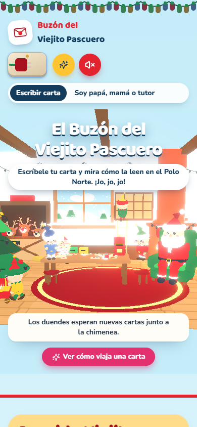

# Buzón del Viejito Pascuero

Web navideña chilena donde niños y niñas le escriben al **Viejito Pascuero**. Un taller 3D del Polo Norte, cálido y de cuento ilustrado, muestra al Viejito, cinco duendes y tres renos recibiendo cada carta. Las cartas se escriben en la web o se mandan como foto de una hoja de verdad: la foto llega tal cual (limpia de metadatos) y, solo si la familia lo acepta, un modelo de IA gratuito transcribe la letra y arma la lista de regalos. Los papás, mamás y tutores siguen el viaje del regalo parada por parada, en tiempo real.


| Móvil | Seguimiento del regalo |
|---|---|
|  |  |

## Levantar todo con un comando

```bash
cp .env.example .env      # en Windows: copy .env.example .env
docker compose up --build
```

Luego abre **http://localhost:8080**. Docker levanta dos servicios: `frontend` (nginx con la web) y `backend` (API en Go, unos 25 MB). La base SQLite, con las fotos de las cartas adentro, vive en el volumen `datos`. Con `DATABASE_URL` (y opcionalmente `REDIS_URL`) el mismo backend usa PostgreSQL y Redis, como en Vercel.

## Publicar en Vercel

Se publican **dos proyectos de Vercel** desde el mismo repo, ambos con planes gratuitos (Vercel Hobby, Neon y, opcional, Redis):

| Proyecto | Root Directory | Qué es |
| --- | --- | --- |
| **backend** | `backend` | API en Go (Vercel la detecta sola por `go.mod` y `cmd/server/main.go`). `backend/vercel.json` define el cron diario. |
| **frontend** | `frontend` | La web. `frontend/vercel.json` arma la salida con `scripts/vercel-output.mjs`: rutas de la SPA, cabeceras de seguridad y el **proxy de `/api/*` al backend**. |

Gracias al proxy el navegador ve un solo dominio (el de la web): las cookies de sesión y el CSRF funcionan igual que en Docker.

**1. Proyecto backend**
- *Storage*: conecta **Neon** (obligatorio, define `DATABASE_URL`) y, si quieres avisos en vivo, **Redis** (opcional, define `REDIS_URL`).
- Variables:

  | Variable | Valor |
  | --- | --- |
  | `ENVIRONMENT` | `production` |
  | `SECRET_KEY` | 48+ caracteres aleatorios |
  | `COOKIE_SECURE` | `true` |
  | `CORS_ORIGINS` | el dominio de la **web**, p. ej. `https://buzon.vercel.app` (valida el origen de los WebSockets) |
  | `TRUST_FORWARDED_FOR` | `true` (Vercel entrega la IP real en `X-Forwarded-For`) |
  | `MAX_UPLOAD_MB` | `4` (Vercel acepta hasta 4,5 MB por petición a Go) |
  | `CRON_SECRET` | un valor aleatorio |
  | `VISION_PROVIDER` + clave | opcional: `gemini`, `groq` u `openrouter` |

- Comprueba `https://<backend>.vercel.app/api/health` → `{"estado":"jo jo jo"}`.

**2. Proyecto frontend**
- Variables (se leen al compilar: vuelve a desplegar si las cambias):

  | Variable | Valor |
  | --- | --- |
  | `BACKEND_URL` | el dominio de producción del backend, p. ej. `https://buzon-backend.vercel.app` (sin barra final). Sin ella la web queda en modo vitrina y `/api` responde 503. |
  | `VITE_WS_URL` | lo mismo con `wss://`, p. ej. `wss://buzon-backend.vercel.app` (el proxy de Vercel no reenvía WebSockets) |
  | `VITE_MAP_TILES_URL` | opcional |

Usa el dominio **estable** de producción del backend (Settings → Domains), no la URL de un despliegue puntual, que cambia en cada push.

En Vercel el backend corre sin procesos de fondo: la carta (y la lectura opcional con IA) se procesa durante la subida, las paradas con hora se completan al consultar el trayecto y el cron diario también avanza paradas y borra fotos vencidas. La web consulta el estado de la carta cada 3 s mientras el Viejito la lee y el seguimiento del niño cada 15 s. Con Redis, además, el seguimiento recibe avisos al instante por WebSocket; sin Redis el backend cierra los WebSockets con el código 4410 y queda solo la consulta. Los avisos de cartas por WebSocket no llegan entre dominios (la cookie de sesión es de la web), por eso esas siempre se consultan.

Si el build nativo de Go fallara por la versión del `go.mod` (1.26), el proyecto backend puede publicarse como contenedor con `backend/Dockerfile`.

Para revisar la salida de la web en local: `cd frontend && BACKEND_URL=https://… npm run build:vercel`.

## Desarrollo local (sin Docker)

**Backend** (Go 1.26 o superior, sin cgo ni servicios externos):

```bash
cd backend
go run ./cmd/server        # http://localhost:8000 · lee ../.env · datos en backend/data/
```

Sin Go instalado: `docker run --rm -p 8000:8000 -v "$PWD/backend:/src" -w /src -e DATA_DIR=/src/data golang:alpine go run ./cmd/server`.

**Frontend:**

```bash
cd frontend
npm install
npm run dev               # http://localhost:5173 (proxy /api y /ws → :8000)
```

Si el backend corre en otro puerto, crea `frontend/.env.local` con `API_TARGET=http://localhost:8010`.

## Calidad

| Comando | Qué revisa |
|---|---|
| `cd backend && go test ./...` | auth (argon2id compatible con el backend anterior, JWT, rotación de refresh), CSRF, CORS, rate limit y `X-Forwarded-For`, permisos entre cuentas, cartas escritas y con foto, IA de visión simulada (con y sin consentimiento, dibujo sin texto, proveedor caído), EXIF/GPS, retención, trayecto y auto-avance, WebSockets |
| `cd backend && go test -race ./...` | lo mismo con el detector de carreras (requiere cgo) |
| `TEST_DATABASE_URL=postgres://… TEST_REDIS_URL=redis://… go test ./...` | la misma batería contra PostgreSQL y Redis, más una prueba con dos instancias en modo Vercel que comparten eventos por Redis |
| `cd backend && go vet ./...` | análisis estático |
| `cd frontend && npm test` | 45 tests de Vitest y Testing Library: stores, luces, tiempos, formulario de carta, interruptor accesible, geometría del Viejito, cinta mágica y entrega de la carta |
| `cd frontend && npm run lint && npm run typecheck` | ESLint (con jsx-a11y) y TypeScript strict |

## Gráficos 3D: skills y validación

El pack [Three.js Awesome Graphics Agent Skills](https://github.com/scottstts/Threejs-Awesome-Graphics-Agent-Skills) (MIT, commit `53eb5a2`) se usó en local desde `.claude/skills/` (no se sube al repo por su peso). Lo que se aplicó a la escena:

- **Exposición y color:** un solo dueño del tone mapping, Neutral (Khronos), que conserva la paleta plana. Lo aplica el renderer cuando no hay postprocesado y el efecto final cuando sí; así la imagen no cambia al bajar la calidad.
- **Bloom:** se calcula en HDR antes del tone mapping, con umbral 1,2 y una jerarquía de emisión con nombre (`EMISSION` en `components/scene/kit.ts`). Solo brillan las ampolletas, la nariz del reno, la cinta dorada y su polvo de estrellas, y la estrella del árbol.
- **Cámara:** riel entre dos planos con una sola etapa de interpolación (resorte críticamente amortiguado y bloqueo exacto al llegar). El parallax va aparte y acotado.
- **Animación procedural:** todo se mueve con `dt` acotado (estable tras suspender la pestaña) y con azar sembrado.

Controles de validación visual por URL (`components/scene/debug.ts`):

| Parámetro | Efecto |
|---|---|
| `?seed=7` | semilla de nieve, polvo de estrellas y orejas |
| `?post=off` | línea base sin postprocesado |
| `?t=4` | congela el reloj de la escena en ese segundo |
| `?quality=0\|1\|2` | fuerza el nivel de calidad |
| `?shot=santa\|santa34\|santaside` | vista fija de inspección del Viejito |

Ejemplo: `/?seed=7&t=4` y `/?seed=7&t=4&post=off` deben verse iguales salvo el brillo del bloom.

## Arquitectura

El plan original, con modelo de datos, endpoints y eventos, está en [docs/PLAN.md](docs/PLAN.md) (escrito para el backend Python anterior; las rutas y los datos se mantienen).

```
frontend/src
  app/              router, layout (guirnalda CSS, interruptor de luces, audio)
  components/scene  escena R3F: sala, chimenea (shader), cielo de día con nubes (shader), nieve instanciada,
                    guirnaldas (1 InstancedMesh + 3 PointLights), Viejito, duendes, renos,
                    cinemática de la carta, cinta dorada mágica, cámara con riel y parallax
  components/ui     botón mágico, sobre lacrado, palanca de luces, loader del trineo, íconos propios
  features/         letters · auth · parents · tracking
  stores/           Zustand: luces (persistidas), escena (máquina de estados), sesión
backend/            Go, un solo binario estático
  cmd/server        main: servidor HTTP, apagado ordenado y -healthcheck para Docker
  internal/api      rutas (net/http), middleware (cabeceras, CORS, rate limit, CSRF), sesión,
                    niños, cartas y su cola de procesamiento, trayecto y auto-avance, WebSockets
  internal/store    SQLite (modernc.org/sqlite, Go puro) o PostgreSQL (pgx) con el mismo SQL; fotos en la base
  internal/security argon2id (formato PHC) y JWT HS256
  internal/imaging  tipo real por magic bytes, orientación EXIF, achicado y re-codificación sin metadatos
  internal/vision   IA de visión opcional: Gemini y API tipo OpenAI (Groq, OpenRouter)
  internal/text     datos sensibles, regalos, ortografía y tono
  internal/hub      reparto de eventos en tiempo real (en memoria o con Redis pub/sub entre instancias)
```

### Cartas

1. **Escrita en la web:** deseos y mensaje. Se tapan los datos sensibles y, si no hay lista de deseos, los regalos se sacan del mensaje ("quiero una pelota y un auto"). Queda leída al instante.
2. **Foto de una hoja de verdad (JPG, PNG o WebP, máx. 10 MB):** se valida el tipo real por *magic bytes*, se endereza según su orientación EXIF, se achica a 2400 px y se vuelve a codificar desde los píxeles, lo que elimina EXIF y GPS. **No hay OCR:** la foto es la carta y llega como leída.
3. **IA de visión (opcional):** si hay `VISION_PROVIDER` con API key **y** el adulto activó la casilla en su panel, un modelo con capa gratuita (Gemini, Groq u OpenRouter) transcribe la letra, la corrige y arma la lista de regalos. Si el modelo no confía en su lectura (por ejemplo, es solo un dibujo) o el proveedor falla, la carta queda solo como imagen.
4. **Datos sensibles:** RUT, teléfonos, correos, direcciones y colegios se reemplazan por `[🔒 dato protegido]`, también en lo que lea la IA.
5. **Transcripción a mano:** el adulto puede escribir el texto y los regalos desde el panel cuando quiera.
6. **Tiempo real:** cada cambio de estado (`recibida → leyendo → leida`) se emite por WebSocket y la escena 3D reacciona. Si el backend se reinicia, retoma las cartas a medio procesar.

### Selfie del Viejito con el árbol

En *Trayecto del regalo*, el adulto puede subir una foto de su árbol de Pascua. Se limpia igual que las cartas (sin EXIF ni GPS) y se guarda en la tabla `tree_photos`. Cuando se completa la parada **¡Bajo el árbol!** (o la última, si no existe esa), la vista del niño revela la selfie que el Viejito Pascuero "se sacó" al dejar el regalo, y se puede descargar.

- **Rutas:** `PUT`, `GET` y `DELETE /api/shipments/{id}/tree` son del dueño. `GET /api/tracking/{código}/selfie` es público, pero responde 404 hasta la entrega, así que antes ni siquiera revela si hay foto. El seguimiento trae `selfie: true` cuando ya está disponible.
- **El filtro se aplica en el navegador** (`frontend/src/features/selfie/compose.ts`), sin IA ni servicios externos. Pone al Viejito en la mitad con menos detalle, para no tapar el árbol. Después lo integra a la foto: tinte y exposición tomados de la imagen, luz cálida del lado del árbol, sombra, flash en la cara, desenfoque leve del fondo, tono de Nochebuena, viñeta, grano parejo y un sello con la hora de la entrega. Una misma foto da siempre la misma selfie.
- La foto del árbol se borra sola según `RETENTION_DAYS`, o cuando el adulto la borra.

### Postal navideña para redes

Cada carta del panel tiene el botón **Crear postal** (`/postal/<id>`). Abre un editor donde la carta del niño (la foto, o el texto si se escribió en la web) se decora para compartir:

- **Formatos:** cuadrada, de 1080×1080, para el feed, o vertical, de 1080×1920, para historias.
- **Diseño:** 11 fondos (noche estrellada, papel kraft, rojo regalo, bosque nevado, rosa chicle, lavanda, hielo, champaña, menta, bastón de dulce y arcoíris pastel), 9 bordes (luces, guirnalda, bastón de dulce, dorado, copos de nieve, corazones, encaje, cinta de regalo o sin borde) y nieve opcional. Los textos llevan un contorno suave para leerse sobre cualquier fondo.
- **Estilos gráficos:** tradicional, anime, acuarela, realista y crayones. Cada estilo transforma el fondo, el borde, los stickers y la tipografía del título y la firma:
  - **Anime:** colores vivos en tonos planos, rayos de luz, contornos oscuros y letras Fredoka con doble contorno.
  - **Acuarela:** pigmento que se corre, papel con textura, bordes secos y letras Dancing Script.
  - **Realista:** luces desenfocadas, viñeta, grano, relieve y sombras, y título dorado en Playfair Display.
  - **Crayones:** trazos de cera y papel que se asoma, con letras Gochi Hand.

  Los efectos se aplican con canvas sobre las mismas ilustraciones, así que cada fondo, borde o sticker nuevo funciona en todos los estilos.
- **Textos:** título y firma editables.
- **Stickers:** 23 ilustraciones propias, en dos grupos: Navidad clásica y Rosado y brillante (corazones, arcoíris, brillitos, reno con corazones, lazo y más). Los stickers y la carta se arrastran, se agrandan y se giran, con el mouse, el dedo o el teclado.
- **Compartir:** en el celular, *Compartir en redes* abre al instante el menú del teléfono (Instagram, WhatsApp, Facebook…). La imagen se prepara mientras editas, y el texto incluye el link de la app. En el computador, *Descargar postal* baja el PNG directo. La postal lleva al pie "Escribe tu carta en <dominio>" para que quien la vea use la app. *Empezar de nuevo* reinicia el diseño (conserva el formato) y se puede deshacer.
- **Guardada en la cuenta:** el diseño de cada carta se guarda en la base (tabla `letter_postcards`) y se puede seguir editando desde cualquier equipo.
  - Se guarda solo, un momento después de cada cambio.
  - El navegador guarda además una copia, por si no hay conexión.
  - La API (`GET`/`PUT /api/letters/{id}/postcard`) guarda solo campos conocidos y validados, y la postal se borra junto con su carta.

Todo se dibuja en un canvas del navegador (`frontend/src/features/postcard/`), así que la vista previa y la imagen final son la misma. Al servidor solo viaja el diseño, nunca la imagen. Antes de publicar, el editor recuerda revisar que en la carta no se vean datos que identifiquen al niño.

### Música navideña

El botón verde con la nota musical, en el encabezado, pone villancicos tocados por el navegador como caja musical, con bajo suave, acordes y cascabeles. Usa WebAudio y no descarga archivos de audio ([`frontend/src/lib/music.ts`](frontend/src/lib/music.ts)).

- **Villancicos:** son solo melodías tradicionales de dominio público:
  - *Cascabel (Jingle Bells)*: Pierpont, 1857.
  - *Adornemos el hogar*: tradicional galés.
  - *Les deseamos feliz Navidad*: tradicional inglés.
  - *Noche de paz*: Gruber, 1818.
- **Reproducción:** se encadenan una tras otra. La flecha junto al botón abre la lista, el botón de siguiente y el volumen.
- **Nunca suena sola:** el navegador exige un toque y es una página para niños. Se recuerdan la canción y el volumen.
- **En segundo plano:** al cambiar de pestaña se pausa y retoma al volver.
- **Tests:** comprueban que cada melodía tenga compases completos y un acorde por compás, para atrapar errores al transcribirlas.

### Animaciones (Framer Motion)

Toda la interfaz usa un mismo lenguaje de movimiento, definido en `frontend/src/lib/motion.ts` (curvas, duraciones y variantes) y `frontend/src/components/ui/MotionBlocks.tsx` (componentes).

- **Aparecer, cambiar y desaparecer:**
  - Al aparecer, los elementos suben un poco con un frenado suave.
  - Al irse, se despiden más rápido.
  - Las listas entran en cascada y sus elementos se pliegan al quitarlos.
- **Mostrar y ocultar:** avisos, errores, formularios y paneles se despliegan con altura animada (`Collapse`).
- **Contenidos que se reemplazan:** carga, vacío, error y pestañas se cruzan con un fundido (`Swap`).
- **Cambio de página:** la página que se va se despide mostrando su propio contenido, y la nueva entra.
- **Selecciones:** las opciones elegidas (pestañas, modos de luces, bordes, canciones) se marcan con una pastilla que se desliza de una opción a otra.
- **Menú del celular:** también anima su cierre antes de cerrarse.
- **Reducir movimiento:** con esa preferencia del sistema (`MotionConfig reducedMotion="user"`), solo quedan fundidos.

La escena 3D del taller (React Three Fiber) tiene sus propias animaciones y no usa Framer Motion.

## Decisiones (y por qué)

Cuando el brief era ambiguo, elegimos la opción más tierna, accesible y segura para niños:

- **Backend en Go, sin OCR.** El backend Python con EasyOCR/TrOCR pesaba unos 3 GB y necesitaba PostgreSQL, Redis y un worker. El de Go es un binario de unos 25 MB: con SQLite en local y Docker, y con PostgreSQL (Neon) y Redis opcional en Vercel.
- **Fotos dentro de la base.** Así son privadas (solo se sirven al dueño), se borran en cascada con la carta y no hace falta un almacenamiento aparte. Mantiene las mismas rutas, campos JSON, cookies y eventos, así que el frontend casi no cambió, y verifica las contraseñas argon2 del backend anterior.
- **Enviar una carta requiere la sesión del adulto.** El niño puede escribir, pero la carta solo se guarda en una cuenta familiar. Para curiosear sin cuenta está el botón *Ver cómo viaja una carta*, que reproduce la cinemática sin guardar nada.
- **La vista del niño es un enlace con código no adivinable** (`/seguimiento/<código>`) y de solo lectura. Muestra apodo, avatar y paradas; nunca cartas ni datos del adulto.
- **Llegada por defecto:** medianoche entre el 24 y el 25 de diciembre, hora de `America/Santiago`. Las fechas se guardan en UTC en texto de ancho fijo (ordenable).
- **El mapa no usa teselas de terceros por defecto.** Dibuja una Sudamérica estilizada de día (mar turquesa, tierra nevada), así no se filtran coordenadas a otros servicios. `VITE_MAP_TILES_URL` permite activar teselas.
- **Retención:** la foto es la carta, así que se guarda (limpia) hasta que el adulto la borre o, como máximo, `RETENTION_DAYS` (60 días).
- **IA externa desactivada por defecto.** Se activa con una casilla explícita en el panel. Sin esa aceptación la foto nunca sale del servidor, aunque `VISION_PROVIDER` tenga una API key.
- **Fuentes autoalojadas** (`@fontsource`), sin llamadas a Google Fonts.
- **El audio siempre arranca silenciado** en cada visita y se sintetiza con WebAudio, sin descargar archivos.
- **`prefers-reduced-motion`:** el vuelo del sobre dura un cuarto y sin estela, sin parallax ni parpadeo de luces, con amplitudes al 15 %. La fase "Leyendo…" conserva su duración porque es estado, no desplazamiento. La UI 2D desactiva sus transiciones.
- **Rendimiento:** DPR limitado a 2 y `PerformanceMonitor` en 3 niveles (sin SMAA → sin Bloom ni luces extra). Las geometrías y materiales son compartidos y la nieve, las ampolletas y el polvo de estrellas son instanciados; las cintas doradas reservan su búfer una sola vez. La escena se carga diferida y la carta se puede escribir antes de que termine de cargar.
- **Estilo visual: taller de cuento.** Sigue el boceto animado y las láminas de referencia del buzón (personajes, duendes y utilería): taller cálido de madera miel y chimenea de piedra, papel crema, verde pino, rojo ladrillo y tinta café. La escena 3D se muestra tal cual se renderiza (toon + bloom), sin filtro de acuarela ni sepia encima. Los colores son tokens propios en `src/styles/index.css` y `PALETTE` en `components/scene/kit.ts`. Antes fue "verano en el Polo Norte" (día saturado); se cambió a pedido explícito.
- **Animación de cuento ilustrado** (referencia: el boceto animado del buzón). Gestos lentos y suaves en vez de rebotes de goma: el Viejito lee la carta con las dos manos frente al pecho, le hace un guiño de mirada al duende, ríe con los ojos cerrados y la carta se vuelve una cinta dorada que envuelve el taller mientras la cámara se aleja. El duende del timbre atrapa la carta, baja de su taburete, rodea el sillón por detrás con la carta en alto, se la entrega al Viejito por el otro costado y vuelve a su taburete a mirarlo con el mentón en las manos (`DELIVERY` en `cinematic.ts`; la cámara queda abierta durante la vuelta y se acerca en la entrega). Los demás duendes aplauden. Todo se amortigua con `dt` (igual a 30, 60 o 120 fps) y usa resortes para la acción secundaria (gorros, panza, barba, orejas). Ver `components/scene/anim.ts` y `cinematic.ts`.
- **Personajes 100 % procedurales.** El Viejito sigue su lámina (`characters/santaModel.ts`): barba en V con mechones, patillas, bigote rizado, gorro con pompón (cadena verlet), brazos con codo, guantes y botas gris carbón, hebilla con estrella y sillón club verde menta; se pone los lentes solo para leer. Los duendes siguen la suya: azul con capucha y bufanda, chaqueta roja con gorro verde, amarillo con el carrito de juguetes y dos verdes con medias a rayas. La utilería incluye el buzón de tapa curva con la puerta abierta, la repisa de renos, la ventana cuadriculada con carámbanos y el árbol tupido con regalos. Ningún personaje con copyright y el reno de nariz roja no tiene nombre de marca.
- **Opcional no incluido:** la mini-escena 3D del trineo en la vista de seguimiento.

## Seguridad

- Contraseñas con argon2id; JWT de acceso de 15 minutos y refresh rotativo de 14 días en cookies `httpOnly` (de un solo uso, con revocación).
- CSRF *double-submit* (`vp_csrf` + `X-CSRF-Token`), CORS estricto y validación de `Origin` en WebSockets.
- Rate limiting por IP, por endpoint de auth y por cuenta en las subidas (en memoria).
- Fotos: tipo real por *magic bytes*, límite de tamaño y de píxeles (contra "bombas de descompresión") y re-codificación sin metadatos; se sirven solo al dueño con `Cache-Control: private, no-store`.
- Cabeceras de seguridad en la API y CSP estricta en nginx y Vercel.
- Con `ENVIRONMENT=production` la app no arranca si `SECRET_KEY` es débil o si `COOKIE_SECURE` está apagado.
- Cada consulta filtra por la cuenta dueña; un recurso ajeno responde 404.
- La imagen Docker es *distroless*, sin shell y con usuario sin privilegios.

## Variables de entorno

Todas están documentadas en [.env.example](.env.example).
